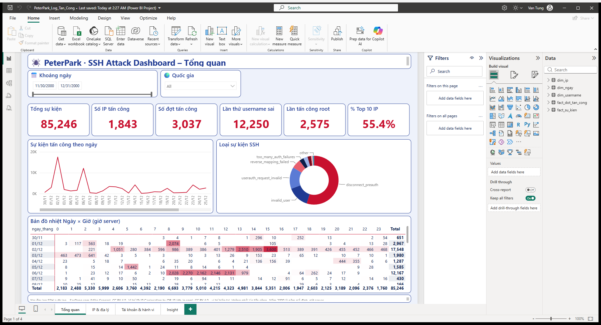
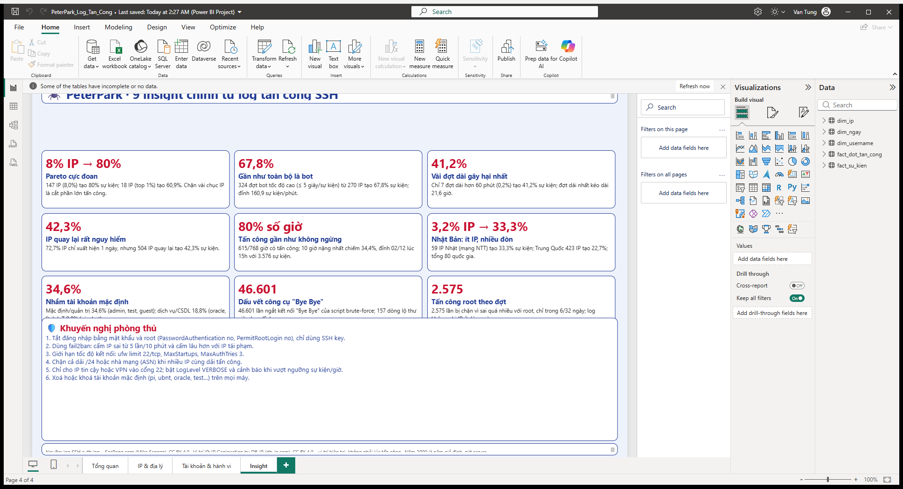
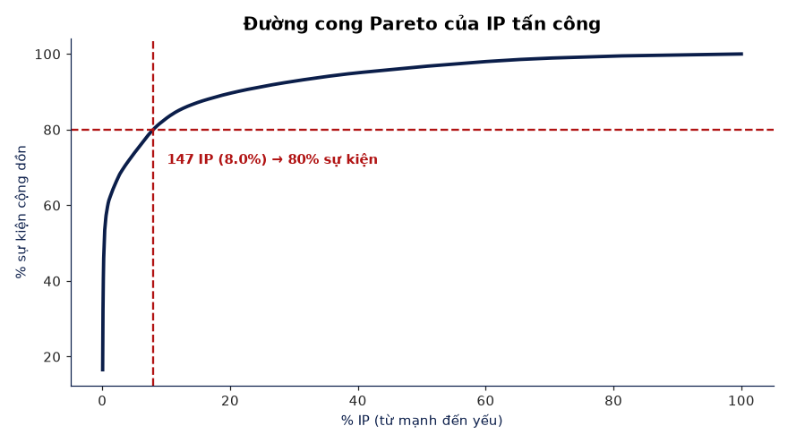
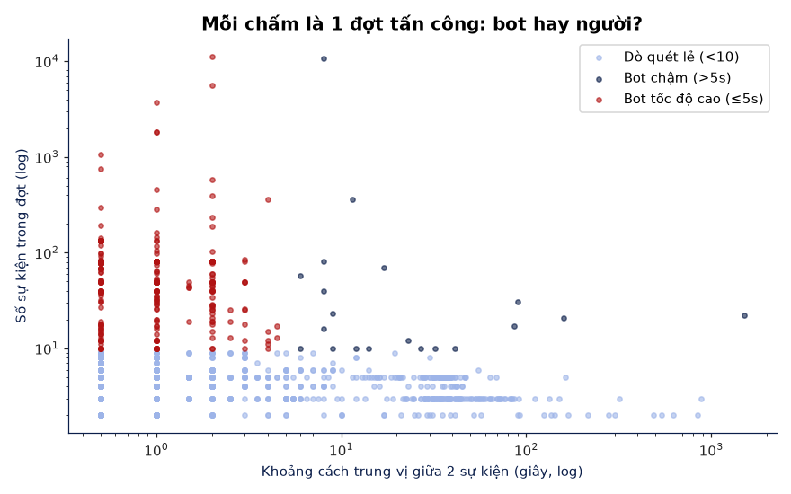
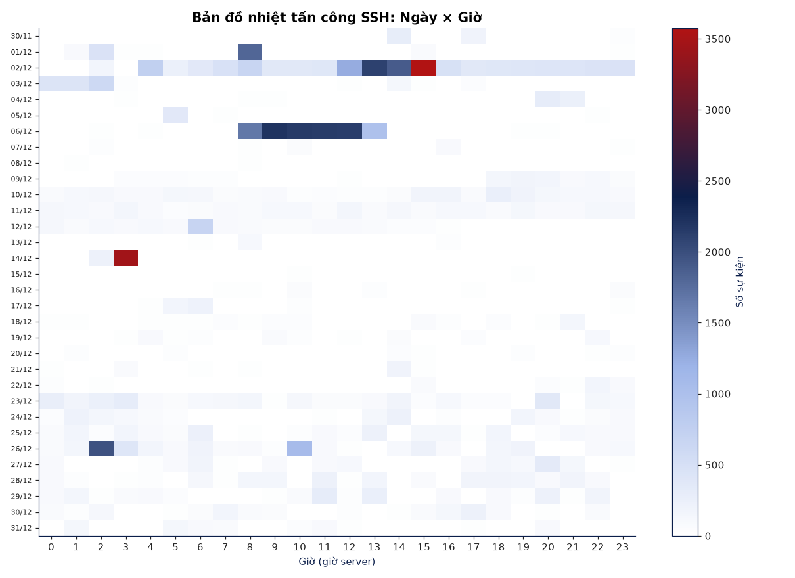
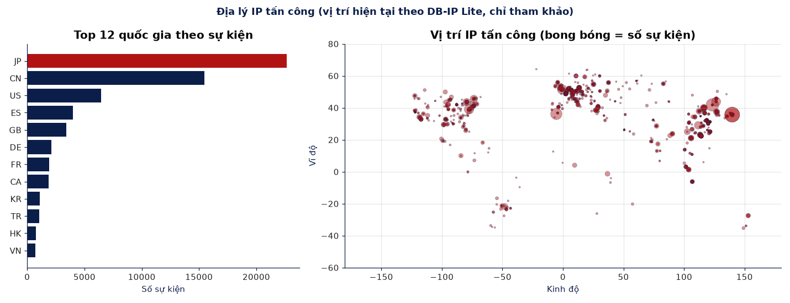

# 🕷️ SSH Attack Log Analysis · Phân tích log tấn công SSH

**Author / Tác giả:** Nguyễn Văn Tùng (PeterPark) · [Portfolio](https://peterpark108.github.io/) · [GitHub](https://github.com/PeterPark108)

A data-analytics × cybersecurity project: parsing a **real public Linux `auth.log`** (86,839 lines, 30 Nov – 31 Dec) to answer *who attacks, when, which accounts they try, how automated they are, and how to defend*. Result: a Python/SQL notebook with 14 charts and a 4-page **Power BI** dashboard (with slicers and an Insight page).

Dự án Data Analytics × An ninh mạng: phân tích file `auth.log` thật của một máy chủ Linux để trả lời *ai tấn công, khi nào, dò tài khoản gì, mức độ tự động ra sao và nên phòng thủ thế nào*. Kết quả gồm notebook Python/SQL với 14 biểu đồ và dashboard **Power BI** 4 trang (có slicer và trang Insight).



## 🔑 Key insights · Phát hiện chính
| # | Insight (EN) | Phát hiện (VI) |
|---|---|---|
| 1 | **1,843** attacking IPs, 85,246 SSH events | 1.843 IP tấn công, 85.246 sự kiện SSH |
| 2 | Extreme Pareto: **147 IPs (8%) → 80%** of events; top 1% (18 IPs) → 60.9% | 147 IP (8%) gây 80% sự kiện; top 1% (18 IP) gây 60,9% |
| 3 | Bots dominate: 324 high-speed bursts (≤ 5 s/event) → **67.8%** of events, peak 160.9 attempts/min | Bot là chủ lực: 324 đợt tốc độ cao tạo 67,8% sự kiện, đỉnh 160,9 lần/phút |
| 4 | 3,037 attack sessions; just 7 sessions > 60 min → **41.2%**; longest 21.6 h / 10,752 events | 3.037 đợt; 7 đợt > 60 phút tạo 41,2%; đợt dài nhất 21,6 giờ |
| 5 | Top IP `61.197.203.243`: 11,261 events in ~5 h | IP mạnh nhất: 11.261 sự kiện trong ~5 giờ |
| 6 | Almost non-stop: attacks in 615/768 hours (**80%**); peak day 02 Dec = 17,548 events | 80% số giờ có tấn công; đỉnh 02/12 với 17.548 sự kiện |
| 7 | 504 returning IPs (≥ 2 days) → **42.3%** of events | 504 IP quay lại tạo 42,3% sự kiện |
| 8 | Japan: 3.2% of IPs (59, NTT networks) but **33.3%** of events; China 423 IPs / 22.7% | Nhật 3,2% IP nhưng 33,3% sự kiện; Trung Quốc 423 IP |
| 9 | 12,250 tries on 542 non-existent usernames (`admin` 1,912); default/admin 34.6%, service/DB 18.8%, IoT 9.8% | 542 username giả bị thử 12.250 lần; mặc định 34,6%, dịch vụ 18,8%, IoT 9,8% |
| 10 | Tool fingerprints: 46,601 "Bye Bye" disconnects (brute-force scripts), 11 IPs using Java JSch | Dấu vết công cụ: 46.601 lần "Bye Bye", 11 IP dùng JSch |
| 11 | `root` cut off for too many failures 2,575 times | `root` bị ngắt 2.575 lần |

**Defensive recommendations / Khuyến nghị:** key-only SSH, `PermitRootLogin no`, fail2ban, rate limiting (`MaxAuthTries`, `ufw limit`), block abusive /24 or ASN ranges, allow-list port 22 / VPN, alerting on event thresholds, remove default accounts (pi, ubnt, oracle…).



| | |
|---|---|
|  |  |
|  |  |

## 🧰 Tech stack
Python (`re`, `pandas`, `matplotlib`) · SQLite / SQL · Jupyter Notebook · Power BI Desktop (PBIP project, star schema, DAX) · DB-IP Lite offline geolocation

## 📁 Structure · Cấu trúc
```
phan_tich_log_tan_cong.ipynb   # main notebook (executed, with outputs)
sql/                           # 8 SQL queries
charts/                        # 14 PNG charts
powerbi/*.csv                  # star schema: fact_su_kien, fact_dot_tan_cong, dim_ip, dim_ngay, dim_username
powerbi/peterpark_theme.json   # Spider-Man red/blue theme
powerbi/dashboard/*.pbip       # Power BI project (4 pages, slicers, Insight page)
HUONG_DAN_POWER_BI.md          # step-by-step Power BI guide (VI) + DAX
geo_lookup.py                  # IP -> country via DB-IP Lite -> data/ip_geo.csv
data/auth.log.gz               # raw data (615 KB) ; download_data.py re-downloads it
images/                        # dashboard screenshots
```

## ▶️ How to run · Chạy lại
```bash
pip install -r requirements.txt
python download_data.py            # optional, data/auth.log.gz is included
jupyter notebook phan_tich_log_tan_cong.ipynb
```
Power BI: open `powerbi/dashboard/PeterPark_Log_Tan_Cong.pbip` in Power BI Desktop and click **Refresh** (update CSV paths in Power Query if your folder differs). To enable the map visual: *File → Options → Security → Map and filled map visuals*.

## ⚠️ Limitations · Giới hạn
- The log has no year; a placeholder year 2000 is used only for ordering.
- IP locations are **current** (DB-IP Lite 2026-10), not at attack time.
- Root-attack lines carry no IP; there are no `Failed/Accepted password` lines, so passwords can't be analysed (server was likely key-only).

## 📜 Data & licenses · Nguồn dữ liệu
- Log: [SecRepo.com – auth.log](https://www.secrepo.com/auth.log/auth.log.gz) by **Mike Sconzo**, licensed [CC BY 4.0](https://creativecommons.org/licenses/by/4.0/). Used in full, unmodified.
- IP geolocation: [IP Geolocation by DB-IP](https://db-ip.com) (DB-IP Lite), licensed [CC BY 4.0](https://creativecommons.org/licenses/by/4.0/).
